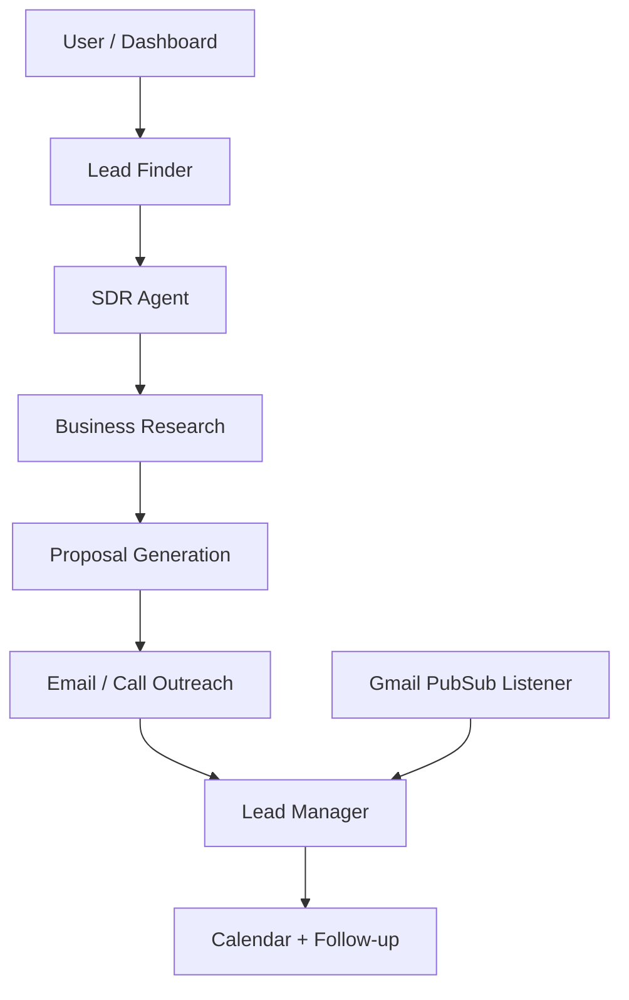

# SalesShortcut

SalesShortcut is a multi-agent AI sales automation platform that discovers leads, researches prospects, drafts personalized outreach, schedules meetings, and manages follow-up through an integrated web dashboard.

The repository combines a Python-based backend, Google Cloud integrations, a web UI, and several specialized agents into a single workflow for outbound sales operations.

## Overview

SalesShortcut is designed to automate the early stages of the sales pipeline:

- Discover local businesses in target cities
- Research company background, offerings, and opportunities
- Prepare tailored proposal and outreach content
- Reach out by email and voice
- Track responses and schedule meetings
- Monitor status in a live dashboard

## Architecture

The system is organized into a small set of specialized services:

- Lead Finder: finds and qualifies potential businesses
- SDR Agent: handles research, proposal generation, and outreach orchestration
- Lead Manager: tracks leads, responses, and scheduling
- UI Client: web dashboard for monitoring and orchestration
- Gmail PubSub Listener: watches incoming email replies and triggers follow-up actions
- Shared utilities: common config, models, and helpers

A typical workflow looks like this:



## Key Features

### Lead Discovery
- Search businesses by city and category
- Use Google Maps and related data sources
- Filter for likely high-intent prospects
- Store lead records in BigQuery

### AI Research and Outreach
- Analyze business websites, reviews, and market positioning
- Generate tailored sales messaging and proposals
- Use LLM-based orchestration for outbound workflows
- Support email and voice outreach channels

### Workflow Automation
- Real-time dashboard updates
- Service-to-service communication over HTTP/APIs
- State tracking for lead lifecycle progression
- Cloud deployment readiness via Docker and Cloud Run scripts

### Monitoring and Operations
- Health checks for each service
- Local and cloud deployment automation
- Environment-based configuration for secure credentials
- Error handling and troubleshooting documentation

## Repository Structure

```text
SalesShortcut/
├── README.md
├── Makefile
├── requirements.txt
├── requirements-dev.txt
├── pyproject.toml
├── config.template
├── .env.example
├── deploy_local.sh
├── deploy_cloud_run.sh
├── update_deployed_constants.sh
├── test_local.sh
├── test_app.py
├── common/
├── gmail_pubsub_listener/
├── lead_finder/
├── lead_manager/
├── sdr/
├── ui_client/
├── Dockerfile.lead_finder
├── Dockerfile.lead_manager
├── Dockerfile.sdr
├── Dockerfile.ui_client
├── Dockerfile.test
├── cloudbuild-*.yaml
├── INSTALLATION.md
├── ENVIRONMENT.md
├── DEPLOYMENT.md
├── BIGQUERY_GOOGLEMAPS_INTEGRATION.md
├── HACKATHON_STORY.md
└── LICENSE
```

## Technology Stack

- Python 3.9+
- FastAPI and Python services
- Google ADK / agent orchestration patterns
- Google Gemini via Google AI APIs
- Google Maps API
- BigQuery for lead data storage
- ElevenLabs for voice outreach
- HTML/CSS/JavaScript for the dashboard UI
- Docker and Google Cloud Run deployment

## Prerequisites

Before starting the project, make sure you have:

- Python 3.9 or newer
- A Google Cloud project
- Google API key for LLM access
- Google Maps API key
- BigQuery enabled in your project
- Optional: ElevenLabs API key for voice calling
- Optional: SMTP/email configuration for outbound email

## Environment Configuration

Copy the template and configure your local environment:

```bash
cp config.template .env
```

Example variables include:

```env
GOOGLE_API_KEY=your_google_api_key
GOOGLE_MAPS_API_KEY=your_google_maps_api_key
GOOGLE_CLOUD_PROJECT=your_project_id
ELEVENLABS_API_KEY=your_elevenlabs_key
EMAIL_USERNAME=your_email@gmail.com
EMAIL_PASSWORD=your_app_password
FROM_EMAIL=your_email@gmail.com
DATASET_ID=lead_finder_data
TABLE_ID=business_leads
```

For full setup details, see:

- INSTALLATION.md
- ENVIRONMENT.md
- DEPLOYMENT.md

## Local Development

### 1. Create a virtual environment

```bash
python -m venv venv
source venv/bin/activate
```

### 2. Install dependencies

```bash
pip install -r requirements.txt
```

Optional development dependencies:

```bash
pip install -r requirements-dev.txt
```

### 3. Start the services

The repository includes helper scripts for local execution:

```bash
./deploy_local.sh
```

Or start services individually:

```bash
python -m lead_finder --port 8081
python -m lead_manager --port 8082
python -m sdr --port 8084
python -m ui_client --port 8000
python gmail_pubsub_listener/gmail_listener_service.py
```

After startup, open the dashboard at:

```text
http://localhost:8000
```

## Service Overview

### Lead Finder
Responsible for discovering prospective businesses in a city and collecting business metadata.

Start command:

```bash
python -m lead_finder --host 0.0.0.0 --port 8081
```

### Lead Manager
Coordinates lead tracking, follow-up workflows, and meeting scheduling logic.

### SDR Agent
Executes the core outreach logic: research, proposal generation, email and voice communication.

### UI Client
Provides a browser-based dashboard for monitoring the system and controlling campaigns.

### Gmail PubSub Listener
Consumes Gmail notifications and triggers lead follow-up automation when new emails arrive.

## Deployment

### Local deployment

```bash
./deploy_local.sh
```

### Docker-based deployment

Example image builds:

```bash
docker build -f Dockerfile.ui_client -t salesshortcut-ui-client .
docker build -f Dockerfile.lead_finder -t salesshortcut-lead-finder .
docker build -f Dockerfile.lead_manager -t salesshortcut-lead-manager .
docker build -f Dockerfile.sdr -t salesshortcut-sdr .
```

### Google Cloud Run

```bash
./deploy_cloud_run.sh
```

## Testing

The repository contains several local validation scripts:

```bash
./test_local.sh
python test_app.py
```

Additional checks may be available per service depending on the project configuration.

## Security and Privacy

- Store secrets in environment variables or secure secret stores
- Do not commit credentials, service account keys, or production API keys
- Review permissions for Google Cloud and email integrations before deploying
- Keep domain-wide delegated access scoped to the minimum required roles

## Contributing

1. Fork the repository
2. Create a feature branch
3. Make a focused change
4. Run relevant validation checks
5. Open a pull request with a clear summary

## License

This project is licensed under the MIT License. See the LICENSE file in the repository for details.

## Support

For setup questions or troubleshooting, refer to:

- README.md
- INSTALLATION.md
- ENVIRONMENT.md
- DEPLOYMENT.md
- Service-specific README files in the component folders

## Summary

SalesShortcut is a practical multi-agent sales automation framework for discovering leads, qualifying prospects, and moving them through an AI-assisted outreach process. It is intended for experimentation, local development, and deployment in cloud environments with Google Cloud and related APIs.

